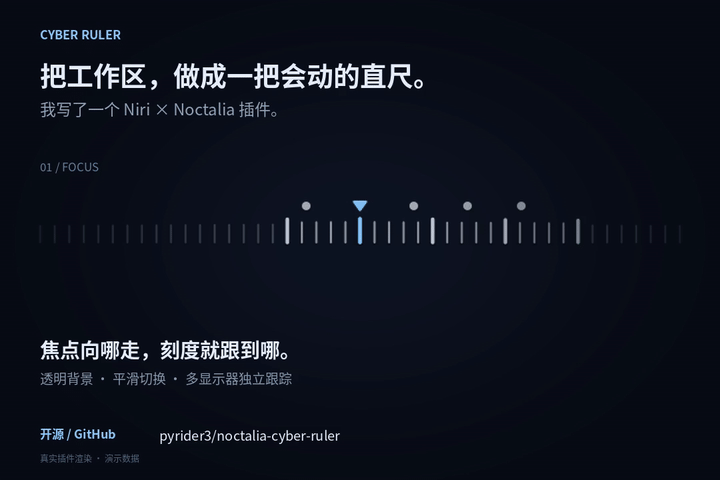
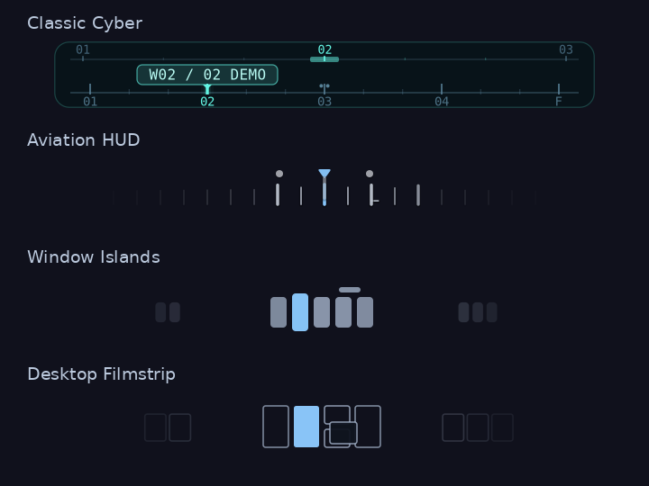

# Cyber Ruler · 赛博刻度尺

A transparent, animated workspace and window navigator for **Niri + Noctalia**.

为 Niri 横向状态栏设计的 Noctalia 插件：四种可切换主题，用图形显示工作区、窗口列、堆叠与悬浮窗口。

## 16 秒演示

[](docs/demo.mp4)

[观看 / 下载高清视频](https://github.com/pyrider3/noctalia-cyber-ruler/raw/refs/heads/main/docs/demo.mp4) · [视频封面](docs/demo-cover.png) · [四主题分享图](docs/themes-social.png)

演示包含焦点跟随、窗口间距自适应、工作区圆点增减、悬浮窗口标记和四主题展示。所有画面由实际插件渲染器生成，使用演示数据。

## 主题预览



> 预览由实际渲染器生成，使用虚构窗口数据，不包含桌面截图。版本 **1.4.5**，MIT License。

## 四种主题

| 主题 | 配置值 | 外观 |
| --- | --- | --- |
| 经典赛博 | `classic` | 青色外框、双层直尺、应用标签，保留最初的设计 |
| 飞行仪表 | `aviation` | 透明渐隐，小圆点工作区、中央蓝色三角与密集窗口刻度 |
| 窗口群岛 | `islands` | 每个工作区由一组圆角窗口薄片组成，当前窗口亮蓝 |
| 桌面底片 | `filmstrip` | 极简窗口轮廓，按平铺列与堆叠行表示桌面布局 |

飞行仪表的工作区点列和窗口直尺分别自适应间距。工作区增减时圆点渐显、渐隐并平滑补位；切换时目标圆点滑入中央三角。窗口主刻度留在中间可辨识区域，经过指针时变蓝，悬停时轻微提亮和伸长。窗口增减仅调整间距，不做展开、收短效果。

悬浮窗口在飞行仪表中独立显示在中央，聚焦时亮蓝，不参与平铺列的间距计算；群岛与底片主题则用叠片表示。底片是布局示意，不复现实际像素宽高，也不捕获窗口内容。多个悬浮窗口的中央标记可能叠合。

### 飞行仪表动态演示


## 环境要求

- Niri，需支持窗口 `pos_in_scrolling_layout` 数据；开发环境为 Niri 26.04。
- Noctalia **5.4.1 / plugin API 43**；本插件使用 Luau 插件 API，不是 QML 插件。
- Python 3.10+、Pycairo、Pillow。
- 横向状态栏；每个显示器单独跟踪其工作区。

Arch Linux 安装依赖：

```sh
sudo pacman -S python python-cairo python-pillow
```

其他发行版请安装对应的 Python Cairo、Pillow 包；也可在 Noctalia 使用的 Python 环境中运行 `python3 -m pip install -r requirements.txt`。Pycairo 构建需要 Cairo 开发库和 pkg-config。

## 安装

```sh
mkdir -p ~/.config/noctalia/plugins
git clone https://github.com/pyrider3/noctalia-cyber-ruler.git \
  ~/.config/noctalia/plugins/cyber-ruler
```

在 Noctalia 的插件来源设置中，添加本地目录 `~/.config/noctalia/plugins`，来源名称使用 `local`，启用 **local/cyber-ruler**。若该来源已经存在，直接启用插件。然后到状态栏设置添加 **Cyber Ruler**。

本插件保留 `local/cyber-ruler` ID；GitHub 仓库名不改变它。需要手动编辑配置时，请合并到已有配置，不要覆盖其他组件：

```toml
# 将路径替换为自己的绝对路径；如果已有此来源，不要重复添加。
[[plugins.source]]
kind = "path"
location = "/home/YOUR_USER/.config/noctalia/plugins"
name = "local"

[widget.cyber-ruler]
type = "local/cyber-ruler:ruler"
capsule = false

[plugin_settings."local/cyber-ruler"]
theme = "aviation"
size_percent = 120
```

在现有 `[plugins]` 的 `enabled` 数组中加入 `"local/cyber-ruler"`，在状态栏的 `center` 列表中加入 `"cyber-ruler"`。默认配置文件位于 `~/.local/state/noctalia/settings.toml`；使用自定义配置时以实际路径为准。

加载修改：

```sh
noctalia msg config-reload
```

右键组件可切换主题、宽度、动画开关和时长。经典主题另有强调色与应用名设置；其他主题支持 80%–160% 整体缩放。插件默认主题为经典赛博。

## 操作

| 主题 | 点击 | 滚轮 |
| --- | --- | --- |
| 经典 / 飞行 | 上排切工作区，下排切窗口；重复点击当前平铺列可轮换堆叠窗口 | 随所在行切换；横向滚动切窗口 |
| 群岛 / 底片 | 点击窗口缩影切窗口，空工作区点击切工作区 | 纵向切工作区，横向切窗口 |

所有主题右键打开设置。关闭窗口显示选项可只显示工作区。操作使用稳定窗口 / 工作区 ID，窗口滚动到边界后停止。

## 更新和卸载

更新：在安装目录运行 `git pull --ff-only`，再执行 `noctalia msg config-reload`。

卸载：先从状态栏移除组件、停用插件，再删除安装目录。需要恢复原生工作区组件时，在状态栏设置中添加 `workspaces`。插件没有修改 Niri 配置。

## 实现与数据

- `widget.luau`：配置、输入与每显示器像素流。
- `ruler.py`：Niri EventStream 模型、共享内存帧传输。
- `window_axis.py`：窗口列、堆叠选择与经典渲染。
- `heading_theme.py`：飞行仪表、平滑运动、圆点生命周期。
- `collection_themes.py`：窗口群岛和桌面底片。

运行时不联网，不捕获窗口内容，不持久化窗口标题。私有状态目录保存心跳、交互状态和当前工作区 / 窗口 ID、应用标签；移除组件后伴随进程自动退出。静止时不持续生成帧，动画期间最高 60 fps，Niri 断线后自动重连。

## 动画衔接修复（1.4.5）

连续反向切换保留瞬时速度；工作区删除后的圆点补位与中央定位使用一致曲线；延迟到达的焦点事件从当前画面继续变形。帧调度按 60 Hz 截止时间唤醒，动画收尾保证输出最终帧。

## 验证

```sh
python3 -m unittest discover -v
noctalia plugins lint .
python3 tools/render_preview.py
```

当前包含 44 项测试，覆盖多显示器模型、列与堆叠、稳定 ID 点击、动画衔接、工作区渐隐 / 补位、悬浮窗口、四主题渲染以及共享内存像素协议。CI 运行 Python 测试；Noctalia lint 需本机安装 Noctalia。
